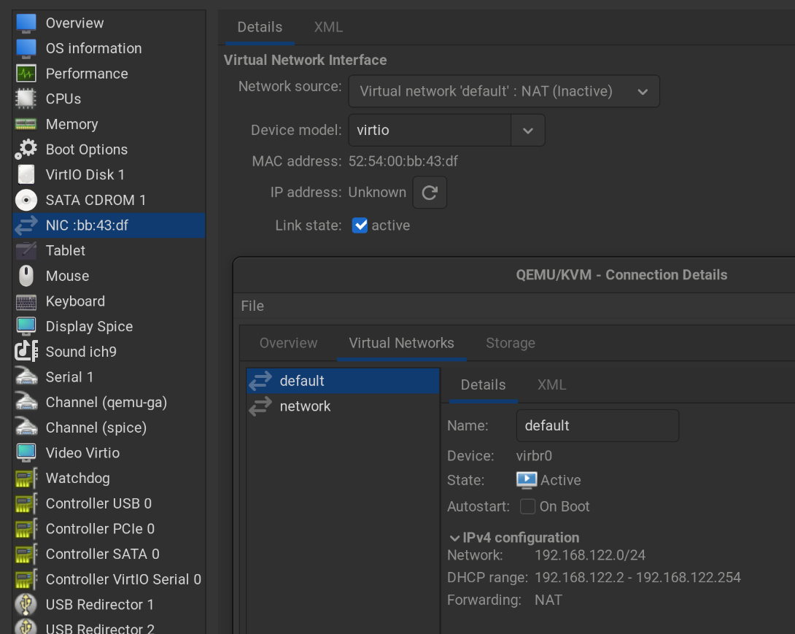
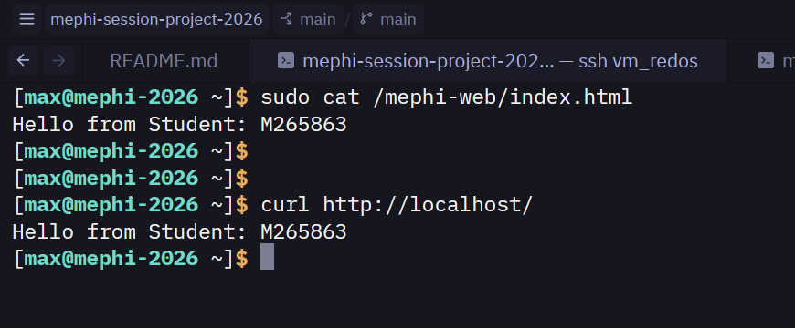

# Сессионный проект по курсу "Безопасность GNU/Linux": Настройка базовых средств защиты ОС GNU/Linux

## 1. Установка дистрибутива

### 1.1. Настройка сети 

Настраиваем *DHCP* на сетевом интерфейсе.



### 1.2. Настройка имени хоста

Настраиваем имя хоста с помощью утилиты *hostnamectl*.

```shell
$ sudo hostnamectl set-hostname "mephi-2026.domain.local"
$ reboot
$ hostname
mephi-2026.domain.local
```

### 1.3. Проверка сетевой связности

```shell
$ ping -c 4 8.8.8.8 > ping.out
$ cat ping.out
PING 8.8.8.8 (8.8.8.8) 56(84) bytes of data.
64 bytes from 8.8.8.8: icmp_seq=1 ttl=113 time=57.2 ms
64 bytes from 8.8.8.8: icmp_seq=2 ttl=113 time=58.0 ms
64 bytes from 8.8.8.8: icmp_seq=3 ttl=113 time=56.6 ms
64 bytes from 8.8.8.8: icmp_seq=4 ttl=113 time=57.4 ms

--- 8.8.8.8 ping statistics ---
4 packets transmitted, 4 received, 0% packet loss, time 3004ms
rtt min/avg/max/mdev = 56.643/57.328/58.044/0.501 ms
```

## 2. Управление программным обеспечением

### 2.1. Обновление дистрибутива

```shell
$ sudo dnf upgrade --refresh
...
Complete!
```

### 2.2. Установка пакетов из репозиториев

```shell
$ sudo dnf install nginx libcap-ng-utils
...
Complete!
```

### 2.3. Установка локального RPM-пакета

```shell
sudo dnf download tcpdump --destdir /tmp
Last metadata expiration check: 0:07:35 ago on Mon 02 Nov 2026 07:45:46 PM MSK.
(1/2): tcpdump-4.99.5-1.red80.x86_64.rpm        1.2 MB/s | 523 kB     00:00
(2/2): tcpdump-4.99.5-1.red80.i686.rpm          1.2 MB/s | 530 kB     00:00
sudo rpm -i /tmp/tcpdump-4.99.5-1.red80.x86_64.rpm
```

## 3. Управление файловыми системами

### 3.1. Создание файловой системы

Создадим и подключим второй диск *vdb*.

```shell
$ lsblk
NAME   MAJ:MIN RM  SIZE RO TYPE MOUNTPOINTS
sr0     11:0    1 1024M  1 rom
zram0  251:0    0  3.8G  0 disk [SWAP]
vda    252:0    0   25G  0 disk
├─vda1 252:1    0    1M  0 part
├─vda2 252:2    0    1G  0 part /boot
├─vda3 252:3    0  2.5G  0 part [SWAP]
└─vda4 252:4    0 21.5G  0 part /
vdb    252:16   0    1G  0 disk
```

Разметим диск с помощью утилиты *cfdisk*.

```shell
$ sudo cfdisk /dev/vdb
```

Создадим файловую систему *ext4* с меткой *MEPHI_WEB*.

```shell
$ sudo mkfs.ext4 -L MEPHI_WEB /dev/vdb1
mke2fs 1.46.3 (27-Jul-2021)
Discarding device blocks: done
Creating filesystem with 261632 4k blocks and 65408 inodes
Filesystem UUID: 1d78a3d5-a0de-43be-8f37-580904512641
Superblock backups stored on blocks:
	32768, 98304, 163840, 229376

Allocating group tables: done
Writing inode tables: done
Creating journal (4096 blocks): done
Writing superblocks and filesystem accounting information: done
```

### 3.2. Монтирование файловой системы

Создадим точку монтирования.

```shell
$ sudo mkdir /mephi-web
```

Добавим запись в файл */etc/fstab* для автоматического монтирования.

```shell
$ echo "LABEL=MEPHI_WEB /mephi-web ext4 defaults 0 2" | sudo tee --append /etc/fstab
```

Выполним ручное монтирование.

```shell
$ sudo mount -a
$ sudo systemctl daemon-reload
$ lsblk
NAME   MAJ:MIN RM  SIZE RO TYPE MOUNTPOINTS
sr0     11:0    1 1024M  1 rom
zram0  251:0    0  3.8G  0 disk [SWAP]
vda    252:0    0   25G  0 disk
├─vda1 252:1    0    1M  0 part
├─vda2 252:2    0    1G  0 part /boot
├─vda3 252:3    0  2.5G  0 part [SWAP]
└─vda4 252:4    0 21.5G  0 part /
vdb    252:16   0    1G  0 disk
└─vdb1 252:17   0 1022M  0 part /mephi-web
```

## 4. Управление сервисами

### 4.1. Управление веб-сервером

Запустим веб-сервер *nginx*.

```shell
$ sudo systemctl enable --now nginx
Created symlink /etc/systemd/system/multi-user.target.wants/nginx.service → /usr/lib/systemd/system/nginx.service.
```

### 4.2. Журналирование

Выведем все сообщения журнала, относящиеся к сервису nginx, для текущей загрузки системы.

```shell
$ journalctl -u nginx -b > journalctl.out
$ cat journalctl.out
Nov 02 20:19:21 mephi-2026.domain.local systemd[1]: Starting nginx.service - The nginx HTTP and reverse proxy server...
Nov 02 20:19:21 mephi-2026.domain.local nginx[941]: nginx: the configuration file /etc/nginx/nginx.conf syntax is ok
Nov 02 20:19:21 mephi-2026.domain.local nginx[941]: nginx: configuration file /etc/nginx/nginx.conf test is successful
Nov 02 20:19:21 mephi-2026.domain.local systemd[1]: Started nginx.service - The nginx HTTP and reverse proxy server.
```

## 5. Управление доступом

### 5.1. Дискреционное управление доступом (DAC)

Создаём группы:

```shell
$ sudo groupadd project
$ sudo groupadd -g 4444 curators
```

Создадим пользователей:

```shell
$ sudo useradd -u 5501 -G project user1
$ sudo useradd -u 5502 -G project user2
$ sudo useradd -u 5503 -G project user3
$ sudo useradd -g curators curator1
$ sudo useradd -g curators curator2
```

Установка прав доступа:

```shell
$ sudo setfacl -m g:project:rwx,g:curators:r-x,o::--- /data/mephi-2026/
$ sudo setfacl -d -m g:project:rwx,g:curators:r-x,o::--- /data/mephi-2026
```

### 5.2. Привилегии (уменьшение количества set-UID-программ)

Проверка до настройки привилегий *tcpdump*:

```shell
$ sudo -u user1 tcpdump
tcpdump: enp1s0: You don't have permission to capture on that device
(socket: Operation not permitted)
```

Настраиваем *capabilities* *tcpdump* так, чтобы его мог запустить обычный пользователь.

```shell
$ sudo setcap cap_net_raw,cap_net_admin=eip $(which tcpdump)
```

Проверка:

```shell
$ sudo -u user1 tcpdump
tcpdump: verbose output suppressed, use -v[v]... for full protocol decode
listening on enp1s0, link-type EN10MB (Ethernet), snapshot length 262144 bytes
22:51:22.393075 IP mephi-2026.domain.local.ssh > _gateway.41694: Flags [P.], seq 3801701088:3801701284, ack 3593748471, win 490, options [nop,nop,TS val 152840616 ecr 247402768], length 196
22:51:22.393187 IP _gateway.41694 > mephi-2026.domain.local.ssh: Flags [.], ack 196, win 146, options [nop,nop,TS val 247402785 ecr 152840600], length 0
...
```

### 5.3. Мандатное управление доступом (MAC)

Убеждаемся, что *SELinux* работает в режиме *enforcing*:

```shell
$ grep "^SELINUX=" /etc/selinux/config
SELINUX=enforcing
```

Устанавливаем правило:

```shell
$ sudo semanage fcontext -a -t httpd_sys_content_t "/mephi-web(/.*)?"
$ sudo restorecon -Rv /mephi-web
Relabeled /mephi-web from system_u:object_r:unlabeled_t:s0 to system_u:object_r:httpd_sys_content_t:s0
Relabeled /mephi-web/lost+found from system_u:object_r:unlabeled_t:s0 to system_u:object_r:httpd_sys_content_t:s0
```

Обновляем конфиг *nginx*:

```shell
$ sudo sed -i 's|root .*/usr/share/nginx/html;|root /mephi-web;|' /etc/nginx/nginx.conf
$ sudo nginx -t
nginx: the configuration file /etc/nginx/nginx.conf syntax is ok
nginx: configuration file /etc/nginx/nginx.conf test is successful
$ sudo systemctl restart nginx.service
```

## 6. Аутентификация

### 6.1. Ограничение входа для пользователей

Выставляем запрет на вход из локальной консоли для кураторов:

```shell
$ sudo usermod -s /sbin/nologin curator1
$ sudo usermod -s /sbin/nologin curator2
```

### 6.2. Управление паролями

Устанавливаем минимальную длину и срок смены пароля:

```shell
$ sudo chage -M 90 user1
$ sudo chage -M 90 user2
$ sudo chage -M 90 user3
$ sudo chage -M 90 curator1
$ sudo chage -M 90 curator2
$ echo "minlen=12" | sudo tee --append /etc/security/pwquality.conf
minlen=12
```

## 7. Тестирование

### 7.1. Создание web-страницы

Создаём файл *index.html*:

```shell
$ echo "Hello from Student: М265863" | sudo tee /mephi-web/index.html
Hello from Student: М265863
```

### 7.2. Проверка доступности

Проверка:

```shell
$ curl http://localhost/
Hello from Student: М265863
```


